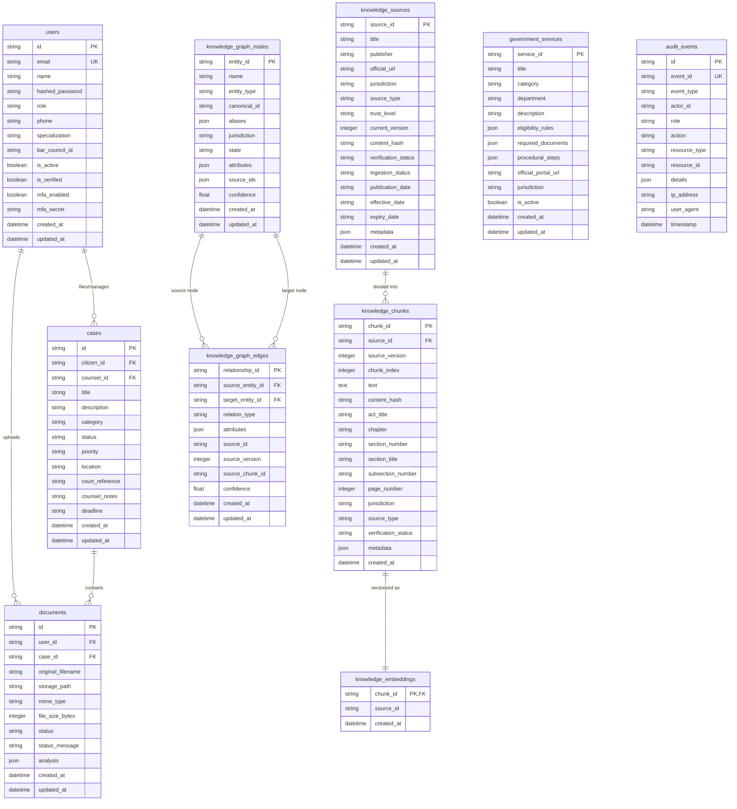

# Chapter 05 — Database Schema, Migrations and Persistence Architecture

**Document Version:** 1.0.0  
**Repository:** `Khushbu112005/Finalyear_MajorProject`  
**Current Baseline Commit:** [`b566c93`](https://github.com/Khushbu112005/Finalyear_MajorProject/commit/b566c93)  
**Investigation Date:** October 28, 2026  
**Primary Database Engine:** PostgreSQL 17.6 (Supabase Hosted) / PostgreSQL 16.15 (Docker Local)  
**Vector Extension:** `pgvector` (0.8.6 / 0.2.5+)  
**Migration Tool:** Alembic (Async runner)  

---

## 1. Database Architecture & Connection Pooling

CivicSphere AI implements an asynchronous, resilient database access layer using **SQLAlchemy 2.0 Asyncio** and the **asyncpg** native driver.

### 1.1 Connection Configuration (`backend/app/common/database.py`)
```python
DATABASE_URL = settings.DATABASE_URL

engine_kwargs = {
    "echo": (settings.ENVIRONMENT == "development" and settings.LOG_LEVEL == "DEBUG"),
    "future": True,
}
if str(DATABASE_URL).startswith("postgresql+asyncpg"):
    engine_kwargs["connect_args"] = {
        "statement_cache_size": 0,      # Required for Supabase transaction pooler (pgBouncer / Supavisor)
        "timeout": 3.0,                  # Fast-fail connection timeout to avoid serverless hanging
        "command_timeout": 5.0,          # Query timeout guardrail
    }

engine = create_async_engine(DATABASE_URL, **engine_kwargs)
AsyncSessionLocal = async_sessionmaker(
    bind=engine,
    class_=AsyncSession,
    expire_on_commit=False,
    autocommit=False,
    autoflush=False,
)
```

### 1.2 Multi-Tier Persistence Strategy
1. **Cloud Production Persistence:** Hosted Supabase PostgreSQL 17.6 via Transaction Pooler (`aws-0-ap-southeast-2.pooler.supabase.com:6543`). The transaction pooler requires `statement_cache_size = 0` to prevent prepared statement conflicts.
2. **Local Infrastructure Stack:** Containerized `pgvector/pgvector:pg16` on port `5432` with pre-installed vector extensions.
3. **In-Memory Cold-Start Hydration:** On Vercel serverless cold starts, `backend/app/main.py::lifespan()` hydrates the in-memory graph repository and vector registry from PostgreSQL in less than 2.0 seconds.

---

## 2. Entity-Relationship Model (Mermaid Diagram)



---

## 3. Database Migration History

The schema evolution is tracked through version-controlled Alembic migrations under `backend/migrations/versions/`.

### Migration `0001_initial_canonical_schema.py`
- **Revision ID:** `0001`
- **Target Tables Created:**
  - `users`: Core identity table with bcrypt hash and role enum.
  - `cases`: Case tracking table with `citizen_id` and `counsel_id`.
  - `documents`: Document store with metadata and analysis JSON.
- **Indexes:** `ix_users_email` (Unique), `ix_users_role`, `ix_cases_citizen_id`, `ix_cases_status`.

### Migration `0002_sync_canonical_models.py`
- **Revision ID:** `0002` (Depends on `0001`)
- **Target Tables Created:**
  - `government_services`: Catalog of welfare schemes, categories, eligibility JSON rules, and document requirements.
  - `audit_events`: Tamper-evident operational and security audit trail.
- **Indexes:** `ix_government_services_category`, `ix_government_services_jurisdiction`, `ix_audit_events_event_type`.

### Migration `0003_pgvector_and_durable_knowledge.py`
- **Revision ID:** `0003` (Depends on `0002`)
- **Key Features:**
  - Automatically creates extension `CREATE EXTENSION IF NOT EXISTS vector;` if running against PostgreSQL.
  - `knowledge_sources`: Authoritative registry of central/state Acts with cryptographic SHA-256 content hashes.
  - `knowledge_chunks`: Micro-chunked sections of statutory acts with precise section, chapter, and act titles.
  - `knowledge_embeddings`: Relational vector mapping table (supporting pgvector vector embeddings).
  - `knowledge_graph_nodes`: Durable graph entities (statutory bodies, rights, sections).
  - `knowledge_graph_edges`: Directed statutory relationships (`ESTABLISHES`, `AMENDS`, `ENFORCES`, `APPEALS_TO`).
- **Foreign Key Cascades:** `ondelete="CASCADE"` from sources to chunks, and from nodes to edges.

---

## 4. Cold-Start Hydration & Ingestion Idempotency

In serverless execution environments (such as Vercel AWS Lambda), processes are ephemeral and memory state is reset upon container recycling.

CivicSphere AI guarantees zero data loss and persistent readiness via **Cold-Start Hydration** in `backend/app/main.py`:

```
Container Start -> lifespan() invoked
       |
       v
Check PostgreSQL for existing Knowledge Sources
       |
       +---> [If Sources Exist]:
       |     1. source_registry.hydrate_from_db() (Populates memory registry from `knowledge_sources`)
       |     2. graph_repository.hydrate_from_db() (Loads 34 nodes from `knowledge_graph_nodes`)
       |     3. vector_store.hydrate_from_db() (Loads 12 vectors from `knowledge_chunks`)
       |     Execution time: ~0.8s -> Readiness Probe returns HTTP 200 with 34 nodes / 12 vectors.
       |
       +---> [If Database Empty]:
             Trigger seed_knowledge_base() -> Ingest RTI Act 2005, DPDP Act 2023, Consumer Protection Act 2019.
```

All source ingestion is **idempotent**: `content_hash` (SHA-256 of cleaned text) prevents duplicate chunking or duplicate graph node insertion.
