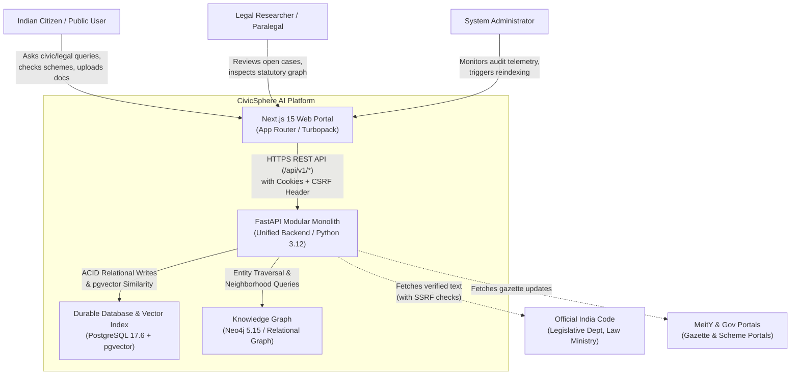
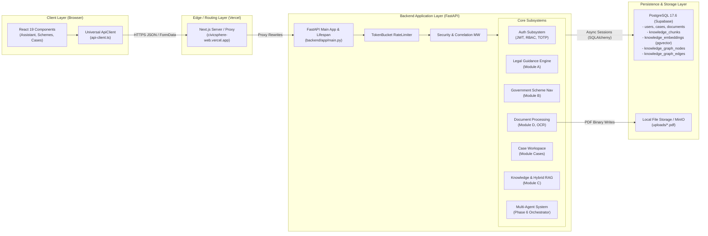
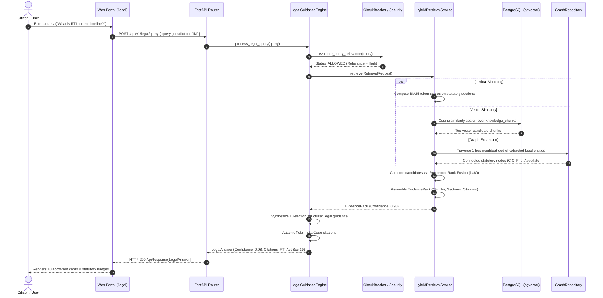
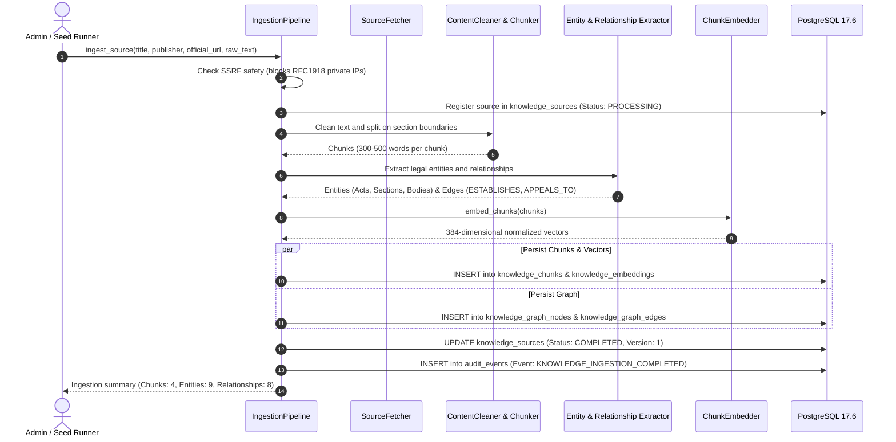
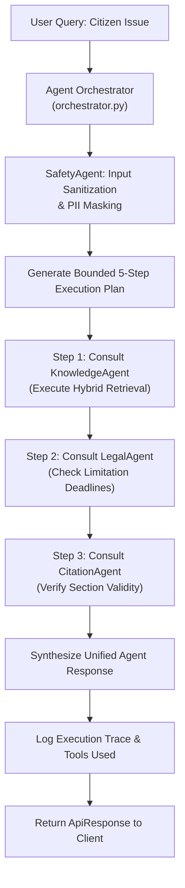

# Chapter 10 — System Architecture and End-to-End Data Flows

**Document Version:** 1.0.0  
**Repository:** `Khushbu112005/Finalyear_MajorProject`  
**Current Baseline Commit:** [`b566c93`](https://github.com/Khushbu112005/Finalyear_MajorProject/commit/b566c93)  
**Investigation Date:** October 28, 2026  

---

## 1. System Context Diagram (C4 Level 1)

### Narrative 1: System Context
The CivicSphere AI platform acts as a secure intermediary between ordinary citizens, legal professionals, and authoritative Indian statutory repositories. Users access the platform via a responsive web client hosted on Vercel. All state-changing and analytical requests flow to the FastAPI backend, which coordinates relational persistence in PostgreSQL, vector searches in pgvector, and graph traversals.

---

## 2. Frontend / Backend / Database Architecture (C4 Level 2)

### Narrative 2: Application Architecture
The architecture is designed as a **Modular Monolith**:
- Code is partitioned into strictly bounded domains (`auth`, `legal`, `government`, `knowledge`, `documents`, `cases`, `agents`, `audit`).
- Modules share a single async database connection pool, eliminating distributed transaction overhead while preserving domain boundaries.
- Cross-module communication is performed via clean Python service calls (e.g. `LegalGuidanceEngine` directly invokes `hybrid_retrieval_service.retrieve`).

---

## 3. End-to-End Legal Question-to-Answer Sequence

### Narrative 3: Legal Query Flow
1. Citizen inputs query in web interface.
2. The query is posted to `/api/v1/legal/query`.
3. The circuit breaker verifies legal and civic relevance.
4. The hybrid retrieval engine concurrently queries BM25 lexical index, pgvector embeddings, and knowledge graph neighborhood.
5. Reciprocal Rank Fusion merges rankings to select top 5 authoritative chunks.
6. A 10-section structured answer is assembled, citing specific sections and India Code URLs.
7. Web portal renders results with an overall confidence score (0.98).

---

## 4. Ingestion Pipeline Sequence Flow

### Narrative 4: Ingestion Pipeline
When statutory acts are ingested:
1. Source URL is evaluated for trust level and SSRF safety.
2. The source record is created in `knowledge_sources` with a SHA-256 content hash.
3. The text is parsed into structured section chunks.
4. Entity and relationship extractors build graph nodes and edges.
5. The chunk embedder generates 384-dimensional dense vectors.
6. Chunks, vectors, graph nodes, and edges are committed in a single atomic database transaction.
7. An audit event is recorded for compliance.

---

## 5. Multi-Agent Orchestration Flow

### Narrative 5: Multi-Agent Coordination
The multi-agent orchestrator decomposes complex citizen requests into a bounded sequence of specialist agent tasks:
- `SafetyAgent` pre-screens inputs for prompt injection and PII.
- `KnowledgeAgent` retrieves grounded statutory evidence.
- `LegalAgent` analyzes procedural remedies and limitation periods.
- `CitationAgent` confirms that all cited enactments exist in the authoritative registry.
- Execution is strictly bounded to a maximum of 5 steps to prevent infinite execution loops.
