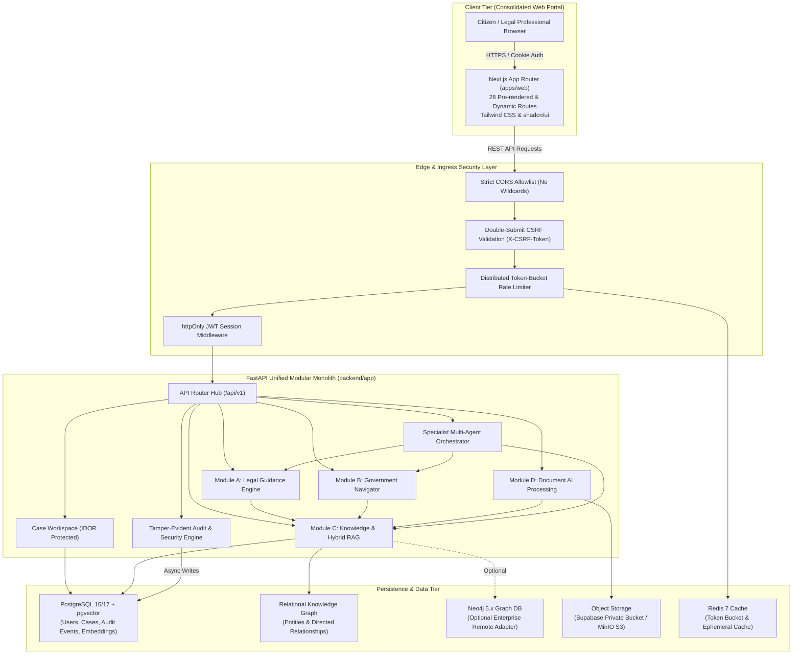
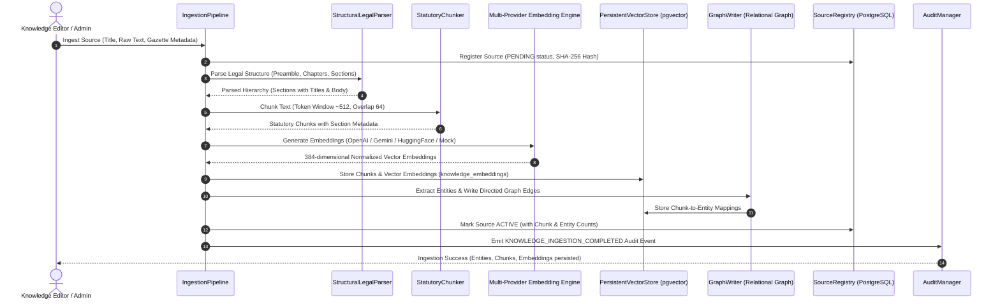
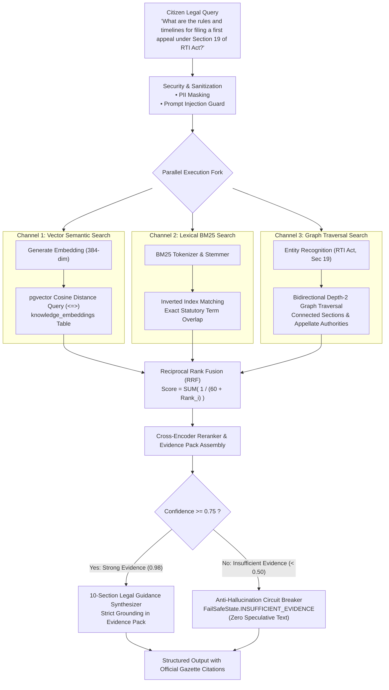
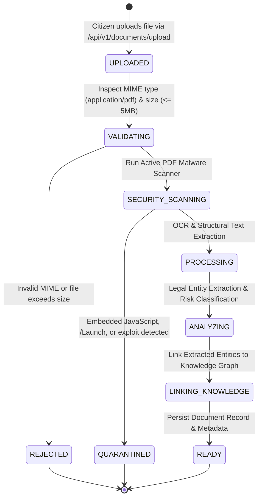
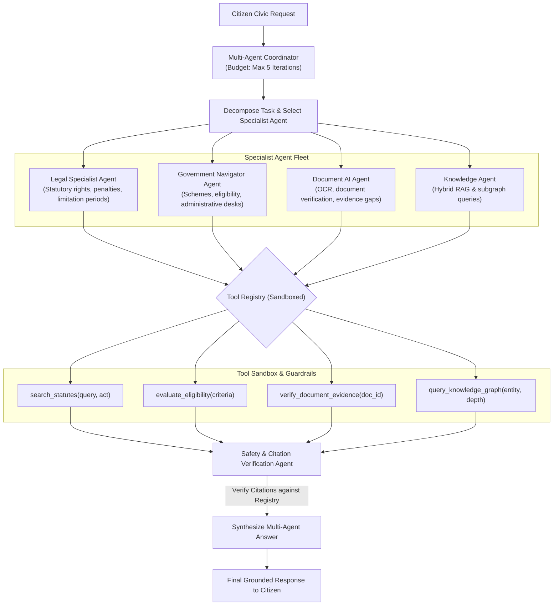
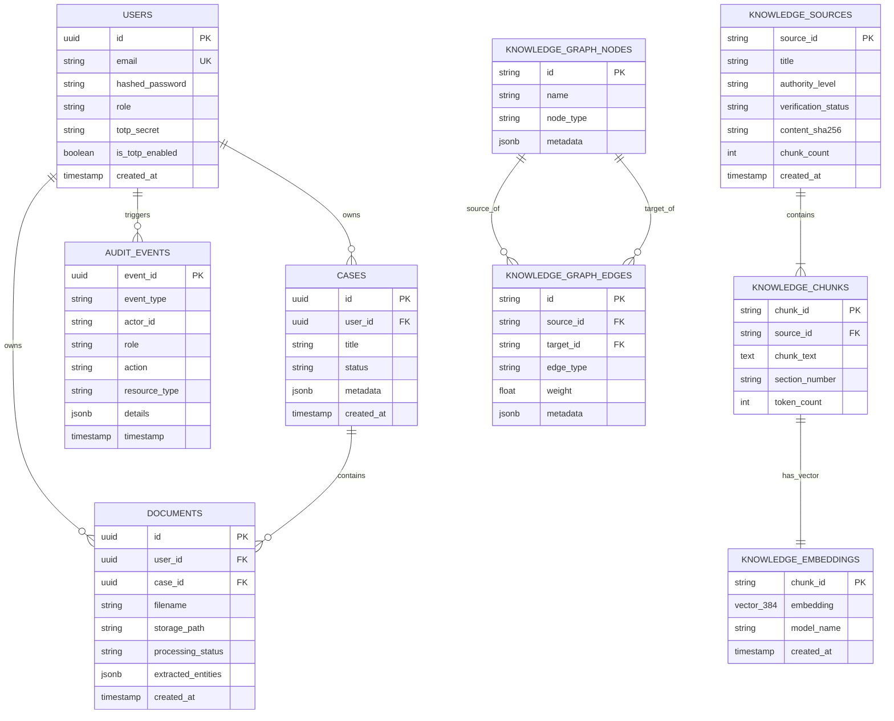

# CivicSphere AI — Architecture & Data Flow Specification

**Document Version:** 2.0  
**Project:** CivicSphere AI (Final Year Major Project)  
**Standard:** Google Deepmind Advanced Agentic Engineering Standard  
**Date:** October 28, 2026  

---

## 1. System Topology & High-Level Architecture

CivicSphere AI is architected as a **high-performance modular monolith** paired with a unified Next.js 14/16 App Router web frontend. The platform centralizes civic intelligence, statutory reasoning, scheme navigation, and document AI into a cohesive, secure, and observable backend.

---

## 2. Ingestion & Knowledge Construction Pipeline

The ingestion pipeline converts raw statutory acts, gazette notifications, and rules into structured, searchable semantic units and knowledge graph subgraphs.

---

## 3. Hybrid Multi-Channel Retrieval & Statutory RAG

Statutory queries require extreme precision to eliminate hallucination. CivicSphere AI executes three distinct retrieval channels in parallel and fuses them using **Reciprocal Rank Fusion (RRF)**.

---

## 4. Intelligent Document AI 7-Stage State Machine

When a citizen uploads an official order, charge sheet, or contract, it transitions through a formal 7-stage state machine with strict security inspection.

---

## 5. Multi-Agent Orchestration & Sandboxed Reasoning

The multi-agent system orchestrates specialized autonomous agents with a bounded reasoning loop to resolve complex, multi-domain civic situations.

---

## 6. Relational Database Schema & Entity Relationships

The canonical persistence layer is modeled with PostgreSQL and SQLAlchemy, incorporating `pgvector` for semantic embeddings.

---

## 7. Security Architecture & Defense-in-Depth

| Security Domain | Defense Mechanism | Implementation Location |
| :--- | :--- | :--- |
| **Authentication** | `httpOnly`, `Secure`, `SameSite` JWT cookies + 24hr expiry | `backend/app/auth/routes.py` |
| **CSRF Defense** | Double-submit CSRF cookie + `X-CSRF-Token` header verification | `backend/app/auth/routes.py`, `backend/app/common/security.py` |
| **Privilege Defense** | Server-authoritative role decorators (`@require_role`) + Public Admin Registration Block | `backend/app/auth/services.py` |
| **Object Authorization** | User-owned case/document IDOR protection via `AuthContext` | `backend/app/cases/routes.py`, `backend/app/documents/routes.py` |
| **Data Boundary Isolation** | Retrieved untrusted data isolated in `<data_boundary is_untrusted_data="true">` | `backend/app/knowledge/security/prompt_injection.py` |
| **Network Defense** | SSRF blocker rejecting private subnets, localhost, and `169.254.169.254` | `backend/app/knowledge/security/ssrf.py` |
| **Privacy Preservation** | Regex masking of Aadhaar, PAN, and phone numbers before logs or LLM calls | `backend/app/knowledge/security/sanitization.py` |
| **Malware Defense** | Active binary stream byte scanner detecting `/JavaScript`, `/Launch`, `/EmbeddedFiles` | `backend/app/documents/services/security_scanner.py` |
| **SQL / Cypher Security**| Strict parameterization with zero dynamic string concatenations | `backend/app/knowledge/graph/repository.py`, `backend/app/common/database.py` |
| **Denial of Service** | Distributed Token-Bucket rate limiter per IP and user ID | `backend/app/common/rate_limiter.py` |
